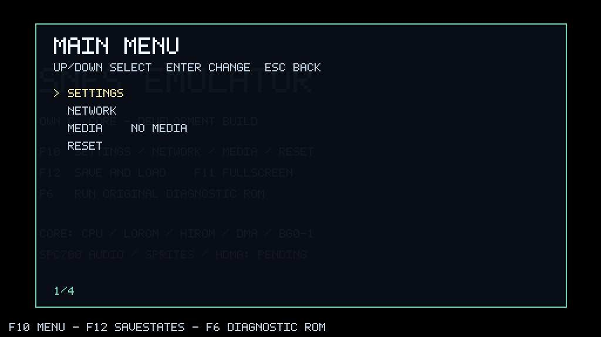
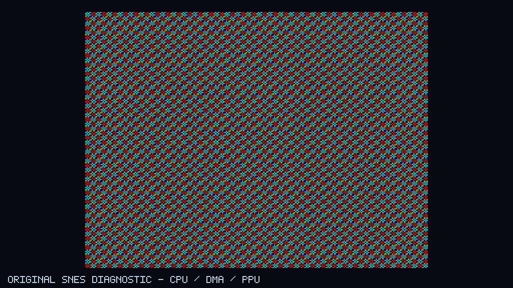
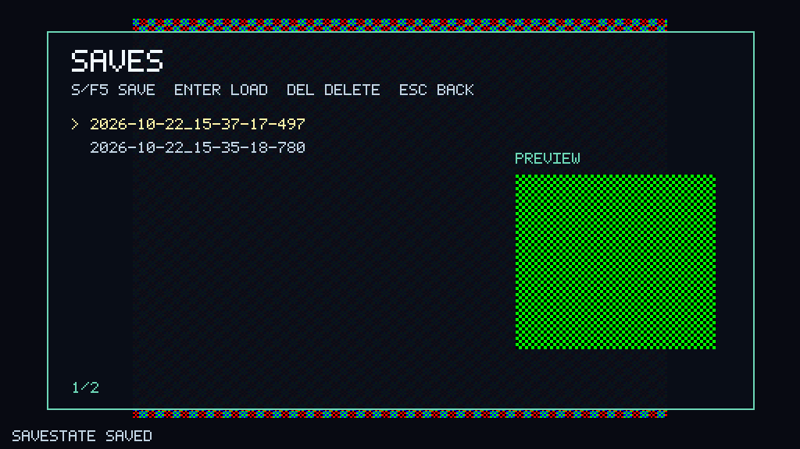

# SNESEmulator

An independently developed SNES emulator in C#, following the interface and
architecture of [C64Emulator](https://github.com/n1k0m0/C64Emulator).
The SNES hardware core is developed in this repository; it does not embed a
Snes9x, bsnes, or Libretro core.

**Status: 0.1.0-preview — experimental, with scoped test evidence and no general
commercial-game or original-hardware certification.** The independently developed
C# core supports clocked Mode 0–7 graphics, SPC700/S-DSP stereo, DMA/HDMA, standard
cartridge mappings, normal format 9 savestates and explicitly configured DSP1
cartridges, explicit SuperFX boards and SA-1 boards with versioned format 10 state. Worker/UI, persistence, networking,
Manager and distribution have independent historical acceptance.

The ordered follow-ups are implemented: [R1 persistence/CI](docs/r1-persistence-ci.md),
[R2 pacing/performance](docs/r2-performance-soak.md), [R3 accuracy](docs/r3-accuracy.md),
[R4 comments](docs/r4-readability.md), DSP1, SuperFX and SA-1.
[Final integration](docs/final-integration.md) passed functional, distribution and
exact implementation-head hosted CI checks. Both actual native hours completed:
PAL passed; NTSC retained 288 post-ready muted fields and 127 remote drops.
Both final core duration tests retained sub-real-time 600-field windows.
**Strict performance/native release acceptance remains open.** Known raw
accuracy and full-sequence audio differences remain separately documented.

Each full CPU contract executes 5,080,400 cases; raw expectations differ in
246 semantic and 264 bus cases after the reviewed indexed-indirect correction.
A separate 264-case supplement documents the zero-filled sparse-RAM completion.
SPC covers 256,000 approved cases, including 7,000 adjudicated raw bus differences.
Three unchanged published functional ROMs also pass in NTSC and PAL.
The original 18 full-sequence whole-console audio comparisons remain red.
An isolated DSP trace matches 89,524 stereo pairs and 191,408 timed echo writes;
this is software-reference evidence under identical external inputs.
No original-console measurements have been made by this project. User-local
Super Mario World and Zelda play observations are separate from formal coverage.

See the [test laboratory](docs/test-laboratory.md),
[M4 APU contract](docs/m4-apu-contract.md),
[M5 PPU contract](docs/m5-ppu-contract.md),
[M6 DSP contract](docs/m6-dsp-contract.md),
[M7 video contract](docs/m7-video-contract.md),
[M8 compatibility contract](docs/m8-compatibility-contract.md), and
[title matrix](docs/m8-title-matrix.md).

## Getting started

Double-click `Start-SNESEmulator.cmd`. In a standalone package, it starts the
included emulator. In a source checkout, it uses a `publish/` package with a
package manifest when available, otherwise it runs the development project. Quoted arguments
containing spaces are forwarded to the application.

A self-contained Windows x64 package includes the emulator, `Manager/`, and
`Updater/`, each with .NET runtime **10.0.13**; no SDK is needed to run it.
Local published packages and test artifacts are not part of a fresh checkout.
The local `publish/` now contains the exact tested final implementation package
(`affae58`); its Core SHA256 and full file identity are recorded in
[final integration](docs/final-integration.md). The previous complete package is
preserved locally under `artifacts/final-integration/previous-publish-preserved/`.
The current documentation commit is separate from the tested package commit.
No public release is currently published.

Development requires the exact SDK version **10.0.402**, pinned in `global.json`.
The following commands assume that SDK is on `PATH`. The local private
toolchain and verification paths are recorded in the
[M9f baseline](docs/baselines/m9f.json).

```powershell
dotnet build SNESEmulator.sln -c Release
dotnet run --project SNESEmulator -c Release
# Optionally, start with your own ROM:
dotnet run --project SNESEmulator -c Release -- "C:\Games\example.sfc"
```

Press `F6` to start the generated diagnostic ROM: a colorful scrolling tile
pattern executed by the C# hardware core. It requires no external ROM files.
Left/right on controller port 1 changes the scroll direction and speed.
Open `.sfc` and `.smc` files through MEDIA, drag and drop, or a command-line
argument. A 512-byte copier header is detected and removed.

The core implements LoROM/HiROM up to 4 MiB and ExLoROM/ExHiROM up to 8 MiB,
with recursive ROM mirroring and SRAM. M3 checks these mappings synthetically;
external M8 programs currently provide evidence only for LoROM and HiROM.
[DSP1/1A/1B setup and evidence](docs/m10a-dsp1.md) now support an own C#
uPD7725 with explicitly supplied, hash-bound local firmware and selected board.
[SuperFX setup and evidence](docs/m10b-superfx.md) adds a scoped own GSU model
with explicit board/clock configuration and shared RAM, graphics, DMA, IRQ and
state integration. [SA-1 setup and evidence](docs/m10c-sa1.md) adds own dual-CPU/MMC/DMA/character-conversion integration. DSP2/3/4 and other cartridge hardware remain unsupported. Original source-author FMULT-R4 and other
accuracy contradictions remain visible; neither chip stage certifies all games.

Updates are disabled by default. Configure your own source under
F10 → SETTINGS → UPDATE SOURCE, then explicitly check through UPDATES in the
main menu. No public release source is configured automatically.

## Controls

The interface follows the C64 project.

| Key | Action |
|---|---|
| F10 | Open MAIN MENU with SETTINGS, NETWORK, MEDIA, RESET, MANAGER, and UPDATES |
| F11 | Toggle fullscreen |
| F12 | Open savestates with screenshot previews and save/load/delete actions |
| F9 | Toggle turbo with a four-times-speed target |
| F6 | Start the custom SNES diagnostic ROM |
| Arrow keys / Enter / Esc | Select / activate / go back in menus |
| S or F5 in the F12 menu | Save a state |
| Enter or L in the F12 menu | Load the selected state |
| Delete in the F12 menu | Delete with an explicit yes/no confirmation |
| Page Up / Page Down in the browser | Move by ten entries |
| Letter in the browser | Select the next matching filename |

Local emulation pauses in menus; clients receive the host's menu status.
SETTINGS includes SHARP/CRT/TV filters, GPU upscaling, fullscreen, gamepad
enablement, controller port, volume, FIT/STRETCH presentation, a custom CPU → SPC → DSP audio diagnostic
ROM, and bindings for the eight SNES action buttons. Gamepads also control the
menus: Start+Select opens F10, A confirms, B goes back, and X saves in the F12
menu. L+R+Select opens F12. Use the D-pad or left stick for directions.
Default button numbers depend on the controller and can be customized.

FIT uses the full available height with a 4:3 image when space permits; narrow
windows fit by width. Optional persistent STRETCH fills the entire client area
horizontally and vertically. SETTINGS and Manager expose the same setting.
Status messages overlay the image for six seconds instead of reserving a footer.

| SNES controller | Keyboard |
|---|---|
| D-pad | Arrow keys |
| B / A | Z / X |
| Y / X | A / S |
| L / R | Q / W |
| Start / Select | Enter / Right Shift |

## Networking

The host/client model and TLS/relay implementation come from the C64 project.
Only the host executes the hardware; clients receive video and send input.
The host assigns connected clients access to port 1, port 2, or both ports,
and can remove clients. Even a PLAYER initially joins without controller
permissions. An OBSERVER role is also available. The C64-specific keyboard
sharing option is not included in the SNES menu.

- LAN: TLS/TCP on port **1991**, with an optional session password.
- RELAY: a separately hosted Python relay on port **1992**, with a connection ID
  and optional relay password. The session also remains end-to-end encrypted.
- Certificates are pinned on first contact. Changed certificates are rejected.
  The CERTIFICATE row opens a dialog showing the old and new fingerprints and
  allows replacement after explicit confirmation.
- Controller input uses 16 bits covering all twelve SNES buttons.
- VID3 uses lossless Deflate compression of complete ARGB frames, with native
  256/512 × 224/239 geometry, field parity, and rational timing information.
  Colors are not reduced to the C64 palette. Unchanged frames are omitted;
  slow clients retain only the newest pending frame.
- Filters and upscaling are local. Session and relay passwords stay in memory.
- The session handshake is `0x534E0004`; audio packets use AUD2. They carry native
  lossless stereo PCM at 32,000 Hz in the default profile, together with sample
  indices, crystal time, and sequence numbers. Bounded queues and separate device
  resampling keep hardware time independent of presentation.

Type directly into fields in the NETWORK menu, edit with Backspace, or clear
with Delete. SERVER PORT currently sets the shared LAN port for host and client.
You can also edit `settings.json` to configure different ports.
Run the relay separately; see the [relay documentation](relay_server/README.md).
Wire versions, relay magic, and default ports are separate from the C64 project.
The two emulators cannot act as clients for each other.

## Architecture

| Main menu | Custom diagnostic ROM | Savestate preview |
|---|---|---|
|  |  |  |

| Project / directory | Responsibility |
|---|---|
| `SNESEmulator.Core` | Platform-independent C# core: CPU, bus, cartridge, PPU, controllers, DMA, SPC700/APU, S-DSP, and savestates |
| `SNESEmulator.Runtime` | Emulation worker, bounded UI handoff, input, pacing, and persistence coordination |
| `SNESEmulator/Frontend` | SharpPixels window, pixel menus, input, and presentation |
| `SNESEmulator/Network` | TLS, host/client, frame/input protocol, relay, and end-to-end encryption |
| `SNESEmulator/Audio` | Stereo device output, volume, and resampling for local/network audio |
| `SNESEmulator.Management` / `SNESEmulatorManager` | Game library, savestate management, settings, and standalone WPF Manager |
| `SNESEmulator.Contracts` | Shared Manager/emulator IPC contracts |
| `SNESEmulator.Updater` | Package verification and explicit update installation |
| `SharpPixels` | OpenTK rendering library with GPU filters, reused from the C64 project |
| `SNESEmulator.Core.Tests` | Portable hardware and runtime regression suites |
| `SNESEmulator.Tests` | Windows frontend and network integration tests |
| `relay_server` | Separate Python TLS relay, including Linux service scripts |
| `scripts` | Build, test, and self-contained Windows x64 publishing scripts |

See [architecture](docs/architecture.md) for implementation details.
The [development plan](docs/development-plan.md) describes the path toward an
accurate base console, the component sequence, and concrete tests and acceptance
criteria for each milestone.

Run the Manager from F10 → MANAGER in the development build, or start
`SNESEmulatorManager/bin/Release/net10.0-windows/SNESEmulatorManager.exe` directly.
See the [Manager/IPC contract](docs/m9-manager-contract.md).

## Data and savestates

Settings, certificates, battery-backed SRAM, and savestates are stored separately
from the C64 project under `%APPDATA%\SNESEmulator`. The default ROM directory is
`%USERPROFILE%\Documents\SNESEmulator`.

Savestates contain the complete **currently implemented** hardware state and a
preview image. They are versioned and bound to the loaded ROM's SHA-256 hash.
Format 9 preserves complete residual phases; formats 1–8 are rejected because
their timing states cannot be migrated unambiguously. Load the same ROM before
loading a state. Invalid states or states from another ROM do not replace the
running machine. Battery-backed SRAM is saved atomically when changing cartridges
and during normal shutdown.

Set `SNESEMULATOR_DATA_DIR` to isolate test data. Tests use their own temporary
directories.

## Testing and publishing a local build

```powershell
.\scripts\build.ps1 -Test
# Portable laboratory checks:
python tools/test-lab.py
# Windows frontend and network integration tests:
dotnet run --project SNESEmulator.Tests -c Release
# Self-contained build that does not require an installed .NET runtime:
.\scripts\publish-win-x64.ps1
```

Hardware tests cover mapping, SRAM, CPU mode changes, selected arithmetic/stack
instructions, controllers, DMA, the diagnostic ROM, and deterministic savestate
continuation. Integration tests check color preservation, every controller bit,
and real TLS and relay connections carrying input and video. The relay test
requires `python` on `PATH` and creates its test certificate using .NET; OpenSSL
is not required.

Headless output and a visual smoke test:

```powershell
$app = '.\SNESEmulator\bin\Release\net10.0-windows\SNESEmulator.exe'
& $app --write-diagnostic-rom diagnostic.sfc
& $app --headless diagnostic.sfc 120 frame.ppm result.txt
& $app --ui-smoke screenshot.png main
# Other views: demo, settings, network, saves
```

The repository includes an updater, an Inno Setup installer definition, and a
game-library Manager. Update checks are disabled until a source is explicitly
configured; no update endpoint points to C64 releases. Packaging and installer
verification limits are documented in the
[distribution contract](docs/m9-distribution-contract.md).

## License and attribution

Apache-2.0; see [LICENSE](LICENSE) and [NOTICE](NOTICE). SharpPixels, the bitmap
menu font, PCM output, and network/relay infrastructure are reused from
C64Emulator. The C64 hardware core was not copied and the original repository
was not modified. No commercial game ROMs or Nintendo firmware are included.

## Test laboratory and historical evidence

`python tools/test-lab.py --windows --full` checks portable core regressions,
Windows/network suites, and the complete pinned external CPU semantic and bus
datasets separately. Without `--full`, unexecuted cases remain explicitly
reported. M8 adds 27 state groups and fixed offline console-reference comparisons
using the freely distributable custom IPL. The local full gate also checks the
original IPL, which is not distributed. A passing regression contract does not
turn known failing accuracy comparisons into passes. See the
[test laboratory](docs/test-laboratory.md) for current suite counts and limits.

The default APU starts a custom open 64-byte boot routine and executes SPC
programs. Original Nintendo IPL firmware is not distributed. Configure a local
64-byte file through `SNESEMULATOR_IPL`; savestates are bound to its hash.
The complete M4 run requires the local original-IPL test input; without it, that
evidence remains explicitly unexecuted. Fetch the MIT-licensed SPC test data
with `python tools/fetch-spc700.py --full`. Provenance and reproduction are
documented in the [M4 contract](docs/m4-apu-contract.md).

The historical M6 full gate on clean commit `feb978b` passed 147 portable groups
(129 existing, 17 DSP, and 1 A/V), 8 Windows groups, all external CPU/SPC vectors,
and original-IPL checks. [Measurements](docs/baselines/m6.json) remain separate
from correctness oracles. The active PPU/APU/DSP diagnostic achieved 18.33 fields/s
locally; the separate two-voice forced-blank audio diagnostic achieved 19.40.
Both were below real time. At that milestone the local `publish/` directory
still contained the pre-M0 build; package renewal followed in M9f.

The historical M7 full gate on clean commit `7cf7cc1` passed 182 portable and
10 Windows groups. Later error-message and laboratory-adapter corrections on
`adef880` were verified separately with targeted checks. Format 8 stored complete
native raw fields and pipeline states and rejected earlier formats with an
explanation; current normal carts retain format 9 while DSP1, SuperFX and SA-1
use the versioned format 10 envelope. VID3 transmits geometry, field parity,
and rational time domains losslessly, while AUD2 retains stereo audio. The GUI
and savestate previews use actual image dimensions with 4:3 presentation.

The M7 PPU/APU/DSP diagnostic workload achieved 23.64 fields/s locally; the
separate two-BRR forced-blank workload achieved 24.29. Both were below real time.
Source/hardware limits, earlier failing findings, and unchanged evidence are
recorded in the [M7 baseline](docs/baselines/m7.json). These historical results
do not establish current sustained-performance or release acceptance.


M10b adds the scoped own C# SuperFX shared-bus model, explicit board configuration,
resumable microphases and separately reported manufacturer/software conflicts.
See [M10b SuperFX](docs/m10b-superfx.md). Its functional diagnostics are separate from the still-red
raw accuracy inventory and local source-author FMULT destination-R4 contradiction.
SA-1 now has a scoped digital implementation; see [M10c SA-1](docs/m10c-sa1.md). Published hardware timing differences remain unverified; [final integration](docs/final-integration.md) records actual long/native outcomes and independent strict release failures.
